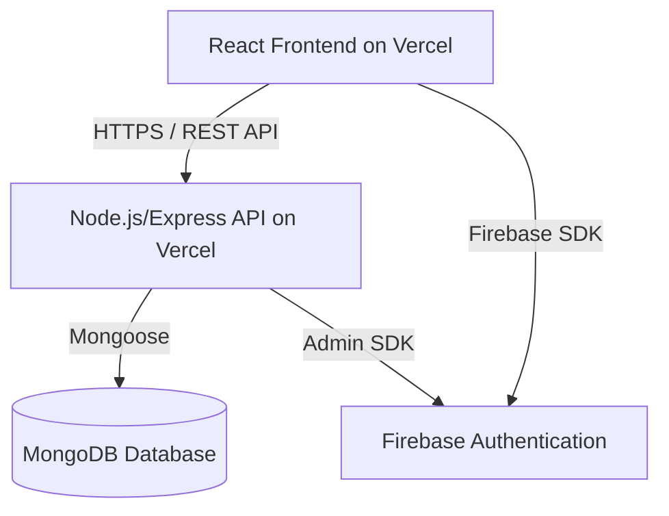

# Visitor Management System (VMS)

A full-stack Visitor Management System built for hospitals and clinics to manage visitor check-ins, access control, and reporting. Built with React (frontend), Node.js/Express (backend), MongoDB (database), and Firebase (OTP & Auth). Both frontend and backend are deployed on Vercel.

## Table of Contents

- [Features](#-features)
- [Tech Stack](#-tech-stack)
- [Architecture](#-architecture)
- [Setup and Installation](#-setup-and-installation)
- [Deployment](#-deployment)
- [Live Demo](#-live-demo)
- [License](#-license)

## 🚀 Features

### 🔐 Authentication & Security
- Secure, token-based API authentication (JWT)
- Firebase OTP for passwordless visitor signup and login
- Role-Based Access Control (Admin, Security, Visitor)

### 📋 Visitor Management
- Register visitors with personal details, Aadhaar number, and a selfie
- Generate a unique QR code for each visitor for contactless entry/exit
- Security dashboard with a live QR code scanner to log visitor access

### 📊 Admin Dashboard
- Manage staff accounts (create new Admin or Security users)
- Generate and download daily visitor reports in XLSX format

### ⚙️ Secure Configuration
- Configured CORS & CSP for secure cross-origin communication between the frontend and backend

## 🛠️ Tech Stack

**Frontend:** React, React Router, Axios, TailwindCSS  
**Backend:** Node.js, Express.js  
**Database:** MongoDB with Mongoose  
**Authentication:** JWT (jsonwebtoken), Firebase Admin SDK  
**File Uploads:** Multer  
**Deployment:** Vercel (Serverless Functions + Static Hosting)

## 📐 Architecture


## ⚡ Setup and Installation

This project is structured as two separate repositories: one for the frontend and one for the backend.

```bash
# Clone both repositories
git clone https://github.com/sanchitpandey/visitpass-react.git
git clone https://github.com/sanchitpandey/visitpass-api.git
```

## Backend Setup

